# E1-1 개발 워크스테이션 구축

코디세이 입학연수 미션 1 "내 컴퓨터에 개발자용 '작업실' 꾸미기" 수행 기록입니다.

## 1. 프로젝트 개요

터미널, Docker, Git을 직접 세팅하고, 같은 서비스를 몇 번 실행해도 같은 결과가 나오는 개발 환경을 만듭니다. 각 단계는 실행 결과(출력, 로그, 접속, 데이터 유지)로 검증했습니다.

- 터미널로 파일과 디렉토리를 다루고 권한을 바꿔봅니다.
- Docker를 설치하고 점검한 뒤 컨테이너를 실행하고 관리합니다.
- Dockerfile로 나만의 웹 서버 이미지를 만들고 포트 매핑으로 접속합니다.
- 바인드 마운트로 "변경 반영"을, 볼륨으로 "데이터 영속성"을 검증합니다.
- Git을 설정하고 GitHub 저장소와 연동합니다.

## 2. 실행 환경

| 항목 | 값 |
|---|---|
| 호스트 OS | Windows 11 Pro (10.0.26300) |
| Linux 환경 | WSL2, Ubuntu 26.04.1 LTS (커널 6.18.54.1-microsoft-standard-WSL2) |
| 터미널 / 쉘 | Windows 터미널 / bash 5.3.9 |
| Docker | Docker Desktop 4.97.0, Docker Engine 29.9.2 |
| Git | 2.53.0 (Ubuntu), 2.56.0 (Windows) |
| 에디터 | VS Code 1.144.0, nano |

```
$ cat /etc/os-release | head -2
PRETTY_NAME="Ubuntu 26.04.1 LTS"
NAME="Ubuntu"

$ docker --version
Docker version 29.9.2, build a82e528

$ git --version
git version 2.53.0
```

### PC에 종속된 부분과 대체 방법

- 이 기록은 Windows + WSL2 + Docker Desktop 기준입니다. macOS에서는 Docker Desktop이나 OrbStack, Linux에서는 Docker Engine을 쓰면 `docker` 명령은 같게 동작합니다.
- 리눅스 권한(`chmod`) 실습은 WSL의 리눅스 파일 시스템(`/home/...`)에서 해야 합니다. Windows 드라이브(`/mnt/c/...`)에서는 권한이 제대로 저장되지 않습니다.
- 바인드 마운트 경로는 `$(pwd)`로 현재 폴더 기준으로 적어서, 사용자 이름이 달라도 그대로 따라 할 수 있습니다.

## 3. 수행 체크리스트

- [x] 터미널 기본 조작 및 폴더 구성
- [x] 권한 변경 실습 (파일 1개, 디렉토리 1개)
- [x] Docker 설치 및 점검 (`docker --version`, `docker info`)
- [x] hello-world 실행
- [x] ubuntu 컨테이너 실행, 내부 명령, attach와 exec 차이 관찰
- [x] 운영 명령 (`images`, `ps`, `ps -a`, `logs`, `stats`)
- [x] Dockerfile 커스텀 이미지 빌드 및 실행
- [x] 포트 매핑 접속 2회 (8080, 8081)
- [x] 바인드 마운트 반영
- [x] 볼륨 영속성
- [x] Git 사용자 정보 및 기본 브랜치 설정
- [ ] 브라우저 접속 화면 캡처 (주소창 포함) → [8-4](#8-4-브라우저-접속-증거)
- [ ] VS Code에서 GitHub 로그인 및 저장소 연동 → [10-2](#10-2-github-연동)

## 4. 저장소 구조

```
e1-1-workstation/
├── README.md            # 이 문서
├── app/                 # 웹 서버 소스
│   ├── Dockerfile
│   └── site/
│       └── index.html
└── docs/
    ├── images/          # 터미널 스크린샷
    └── logs/            # 상세 명령 로그
        ├── port_mapping.md
        └── bind_mount_volume.md
```

## 5. 검증 방법 요약

| 항목 | 확인한 명령 | 확인한 것 | 증거 |
|---|---|---|---|
| 터미널 조작 | `pwd`, `ls -la`, `mkdir`, `cp`, `mv`, `rm` 등 | 생성, 복사, 이름변경, 삭제 결과 | [6-1](#6-1-터미널-기본-조작) |
| 권한 | `ls -ld`, `chmod` | 644→600, 755→700 변경 전/후 | [6-2](#6-2-권한-변경) |
| Docker 점검 | `docker --version`, `docker info` | 엔진(Server) 응답 | [7-1](#7-1-설치-및-점검) |
| 운영 | `docker images`, `ps -a`, `logs`, `stats` | 컨테이너 상태, 접속 로그, 자원 사용량 | [7-2](#7-2-hello-world와-컨테이너-목록) ~ [7-5](#7-5-로그와-리소스-확인) |
| 커스텀 이미지 | `docker build`, `docker run` | 빌드 성공, 내 페이지 응답 | [8](#8-dockerfile-커스텀-이미지) |
| 포트 매핑 | `curl localhost:8080`, `:8081` | 같은 이미지, 다른 호스트 포트 2개 | [8-3](#8-3-포트-매핑-2회) |
| 바인드 마운트 | 호스트 파일 수정 후 `curl` | 재빌드 없이 즉시 반영 | [9](#9-바인드-마운트와-볼륨) |
| 볼륨 | 컨테이너 삭제 후 새 컨테이너에서 `cat` | 데이터 유지 | [9](#9-바인드-마운트와-볼륨) |
| Git | `git config --list` | 사용자 정보, 기본 브랜치 | [10](#10-git-설정과-github-연동) |

---

## 6. 터미널과 권한

### 6-1. 터미널 기본 조작

현재 위치 확인, 숨김 파일 포함 목록, 폴더 생성과 이동, 빈 파일 생성, 내용 쓰기와 확인, 복사, 이름변경, 삭제를 수행했습니다.

```
$ pwd
/home/qphanmj

$ ls -la
total 28
drwxr-x--- 4 qphanmj qphanmj 4096 Nov  3 00:18 .
drwxr-xr-x 3 root    root    4096 Nov  3 00:15 ..
-rw-r--r-- 1 qphanmj qphanmj  220 Nov  3 00:15 .bash_logout
-rw-r--r-- 1 qphanmj qphanmj 3771 Nov  3 00:15 .bashrc
drwxr-x--- 4 qphanmj qphanmj 4096 Nov  3 00:18 .cache
drwxr-x--- 3 qphanmj qphanmj 4096 Nov  3 00:18 .config
-rw-rw-r-- 1 qphanmj qphanmj    0 Nov  3 00:18 .motd_shown
-rw-r--r-- 1 qphanmj qphanmj  807 Nov  3 00:15 .profile

$ mkdir -p ~/codyssey/practice
$ cd ~/codyssey/practice
$ touch empty.txt
$ echo "Hello Codyssey" > hello.txt
$ cat hello.txt
Hello Codyssey
$ cp hello.txt hello_copy.txt
$ mv hello_copy.txt renamed.txt
$ rm empty.txt
$ ls -la
total 16
drwxr-xr-x 2 qphanmj qphanmj 4096 Nov  3 23:54 .
drwxr-xr-x 3 qphanmj qphanmj 4096 Nov  3 23:53 ..
-rw-r--r-- 1 qphanmj qphanmj   15 Nov  3 23:53 hello.txt
-rw-r--r-- 1 qphanmj qphanmj   15 Nov  3 23:53 renamed.txt
```

- `hello.txt`가 15바이트인 이유: "Hello Codyssey" 14글자에 `echo`가 붙인 줄바꿈 1바이트가 더해졌습니다.
- `hello_copy.txt`는 `mv`로 `renamed.txt`가 되었고, `empty.txt`는 `rm`으로 삭제되었습니다.

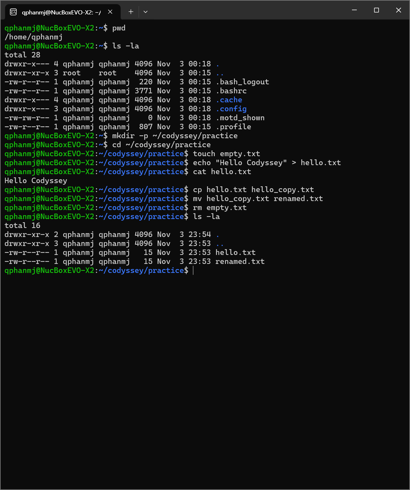

### 6-2. 권한 변경

파일 1개(`hello.txt`)와 디렉토리 1개(`secret`)의 권한을 바꾸고 변경 전/후를 비교했습니다.

```
$ mkdir secret
$ ls -ld hello.txt secret
-rw-r--r-- 1 qphanmj qphanmj   15 Nov  3 23:53 hello.txt
drwxr-xr-x 2 qphanmj qphanmj 4096 Nov  4 12:33 secret

$ chmod 600 hello.txt
$ chmod 700 secret

$ ls -ld hello.txt secret
-rw------- 1 qphanmj qphanmj   15 Nov  3 23:53 hello.txt
drwx------ 2 qphanmj qphanmj 4096 Nov  4 12:33 secret
```

| 대상 | 변경 전 | 변경 후 | 의미 |
|---|---|---|---|
| `hello.txt` | `rw-r--r--` (644) | `rw-------` (600) | 소유자만 읽기/쓰기 |
| `secret` | `rwxr-xr-x` (755) | `rwx------` (700) | 소유자만 목록 보기/쓰기/들어가기 |

- 파일은 실행할 필요가 없어서 600, 디렉토리는 `x`(들어가기)가 있어야 `cd`할 수 있어서 700으로 했습니다.
- `chmod`는 내용을 바꾸지 않으므로 `ls -l`의 수정 시각(`Nov 3 23:53`)은 그대로입니다.

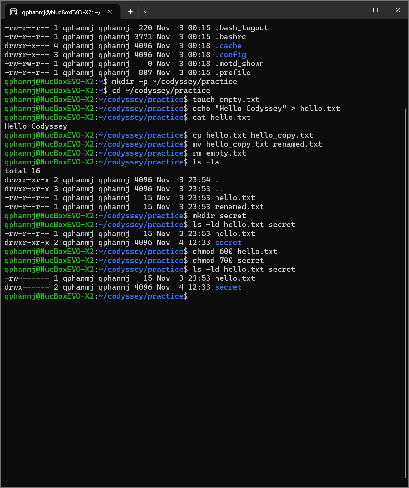

---

## 7. Docker 설치, 점검, 운영

### 7-1. 설치 및 점검

Docker Desktop을 설치하고 WSL integration에서 Ubuntu를 켠 뒤 Ubuntu 터미널에서 확인했습니다.

```
$ docker --version
Docker version 29.9.2, build a82e528

$ docker info
...
Server:
 ...
 Images: 1
 Server Version: 29.9.2
 Storage Driver: overlayfs
 ...
 Kernel Version: 6.18.54.1-microsoft-standard-WSL2
 Operating System: Docker Desktop
 OSType: linux
 Architecture: x86_64
 CPUs: 32
 Total Memory: 15.44GiB
 Name: docker-desktop
 ...
```

`Server:` 아래에 `Server Version`이 나오므로 Docker 엔진(데몬)이 동작하고 있습니다.

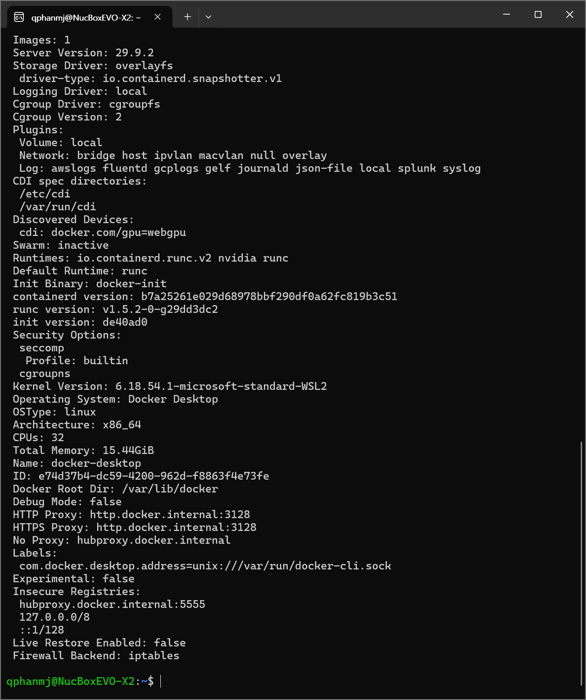

### 7-2. hello-world와 컨테이너 목록

```
$ docker run hello-world

Hello from Docker!
This message shows that your installation appears to be working correctly.
...

$ docker ps
CONTAINER ID   IMAGE     COMMAND   CREATED   STATUS    PORTS     NAMES

$ docker ps -a
CONTAINER ID   IMAGE         COMMAND    CREATED          STATUS                      PORTS     NAMES
cf8e538adcdc   hello-world   "/hello"   15 seconds ago   Exited (0) 14 seconds ago             clever_nash
316d38a253b9   hello-world   "/hello"   56 seconds ago   Exited (0) 54 seconds ago             vigorous_shirley
c073265f9f18   hello-world   "/hello"   7 minutes ago    Exited (0) 7 minutes ago              laughing_hypatia
```

- 이미지가 이미 있어서 `Unable to find image ...` 없이 바로 실행되었습니다.
- hello-world는 메시지를 출력하고 끝나므로 `docker ps`(실행 중)에는 없고 `docker ps -a`(전체)에만 보입니다.
- `Exited (0)`의 0은 정상 종료라는 뜻입니다. `docker run`을 할 때마다 새 컨테이너가 생겨서 3개가 쌓였습니다.

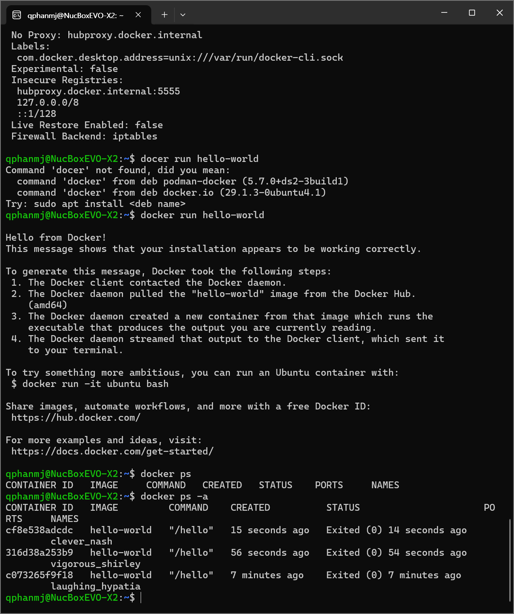

### 7-3. ubuntu 컨테이너 내부 진입

```
$ docker run -it --name my-ubuntu ubuntu bash
Unable to find image 'ubuntu:latest' locally
latest: Pulling from library/ubuntu
...
Status: Downloaded newer image for ubuntu:latest
root@3c32c8abd5ec:/# ls
bin  boot  dev  etc  home  lib  lib64  media  mnt  opt  proc  root  run  sbin  srv  sys  tmp  usr  var
root@3c32c8abd5ec:/# echo "Hello from container"
Hello from container
root@3c32c8abd5ec:/# exit
exit

$ docker ps -a
CONTAINER ID   IMAGE     COMMAND   CREATED          STATUS                     PORTS     NAMES
3c32c8abd5ec   ubuntu    "bash"    46 seconds ago   Exited (0) 6 seconds ago             my-ubuntu
...
```

- 이미지가 없어서 Docker Hub에서 내려받았습니다(`Pulling from library/ubuntu`).
- 프롬프트의 `3c32c8abd5ec`는 컨테이너 ID와 같고, `ls`에는 호스트의 파일이 보이지 않습니다. 컨테이너가 격리된 파일 시스템을 가진다는 뜻입니다.
- 컨테이너는 안에서 실행한 프로그램(bash)이 살아 있는 동안만 실행되므로, `exit` 후 `Exited (0)`가 되었습니다.

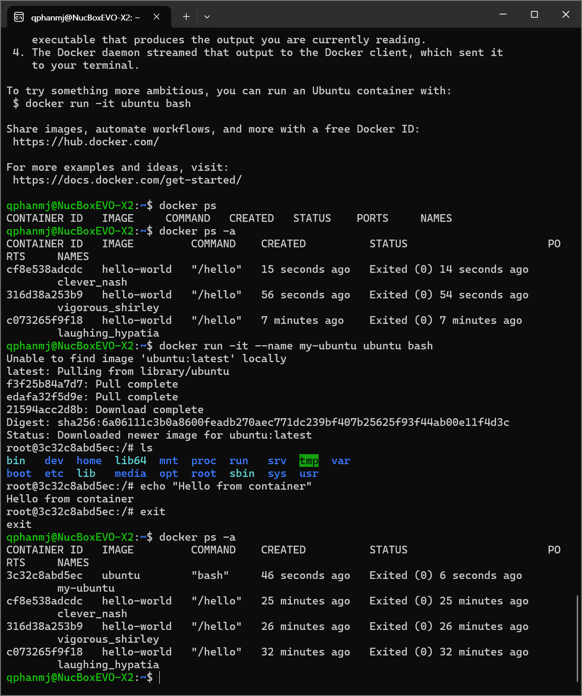

### 7-4. attach와 exec의 차이

```
$ docker start my-ubuntu
my-ubuntu
$ docker ps
CONTAINER ID   IMAGE     COMMAND   CREATED              STATUS         PORTS     NAMES
3c32c8abd5ec   ubuntu    "bash"    About a minute ago   Up 5 seconds             my-ubuntu

$ docker exec -it my-ubuntu bash
root@3c32c8abd5ec:/# exit
exit
$ docker ps
CONTAINER ID   IMAGE     COMMAND   CREATED         STATUS          PORTS     NAMES
3c32c8abd5ec   ubuntu    "bash"    2 minutes ago   Up 26 seconds             my-ubuntu

$ docker attach my-ubuntu
root@3c32c8abd5ec:/# exit
exit
$ docker ps -a
CONTAINER ID   IMAGE     COMMAND   CREATED         STATUS                     PORTS     NAMES
3c32c8abd5ec   ubuntu    "bash"    2 minutes ago   Exited (0) 5 seconds ago             my-ubuntu
```

| 구분 | `docker attach` | `docker exec -it ... bash` |
|---|---|---|
| 연결 대상 | 컨테이너의 메인 프로세스(처음 실행한 bash) | 새로 실행한 프로세스(새 bash) |
| `exit` 하면 | 메인 프로세스가 끝나서 컨테이너 **종료** | 새 프로세스만 끝나고 컨테이너는 **유지** |
| 관찰 결과 | `Exited (0)` | `Up` |

attach 상태에서 컨테이너를 멈추지 않고 나오려면 `exit` 대신 `Ctrl+P`, `Ctrl+Q`를 누릅니다. 실행 중인 컨테이너를 들여다볼 때는 보통 exec를 씁니다.

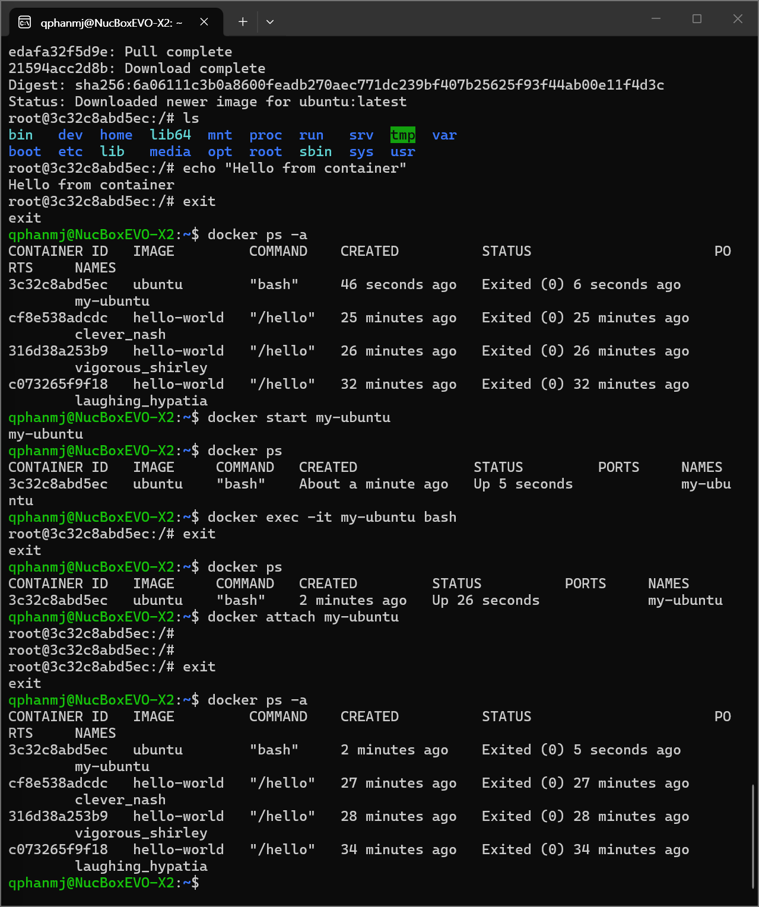

### 7-5. 로그와 리소스 확인

```
$ docker run -d --name web-test -p 8080:80 nginx
$ curl http://localhost:8080
(nginx 기본 페이지 HTML 출력. 접속 기록은 아래 docker logs 마지막 줄)

$ docker logs web-test
...
2026/11/04 14:45:40 [notice] 1#1: nginx/1.31.8
2026/11/04 14:45:40 [notice] 1#1: start worker processes
2026/11/04 14:45:40 [notice] 1#1: start worker process 29
...
2026/11/04 14:45:40 [notice] 1#1: start worker process 60
172.17.0.1 - - [04/Nov/2026:14:46:42 +0000] "GET / HTTP/1.1" 200 896 "-" "curl/8.18.0" "-"

$ docker stats --no-stream
CONTAINER ID   NAME       CPU %     MEM USAGE / LIMIT     MEM %     NET I/O           BLOCK I/O     PIDS
1e68c4e167e2   web-test   0.00%     27.33MiB / 15.44GiB   0.17%     1.8kB / 1.68kB    0B / 12.3kB   33
```

- 로그 마지막 줄이 `curl` 접속 기록입니다. `GET /` 요청에 `200`(성공)으로 응답했습니다.
- nginx가 CPU 32개에 맞춰 worker 32개(29~60번)를 만들었고, `stats`의 PIDS 33은 worker 32개와 관리 프로세스 1개입니다.

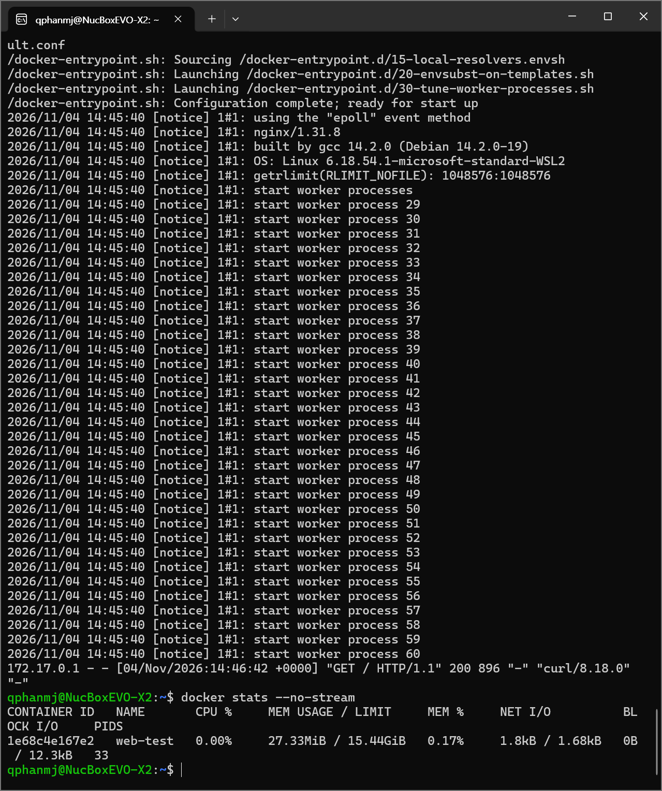

---

## 8. Dockerfile 커스텀 이미지

### 8-1. 베이스와 커스텀 포인트

방식 (A): 웹 서버 베이스 이미지 + 정적 콘텐츠 교체. 베이스는 공식 이미지 `nginx:alpine`입니다.

[app/Dockerfile](app/Dockerfile)

```dockerfile
FROM nginx:alpine
LABEL org.opencontainers.image.title="my-custom-nginx"
ENV APP_ENV=dev
COPY site/ /usr/share/nginx/html/
```

| 커스텀 포인트 | 목적 |
|---|---|
| `FROM nginx:alpine` | 가벼운 alpine 기반 nginx를 베이스로 선택 |
| `LABEL ...title` | 이미지에 이름 메타데이터를 붙여 식별 |
| `ENV APP_ENV=dev` | 실행 환경을 환경 변수로 표시 |
| `COPY site/ ...` | nginx 기본 페이지를 내 페이지([app/site/index.html](app/site/index.html))로 교체 |

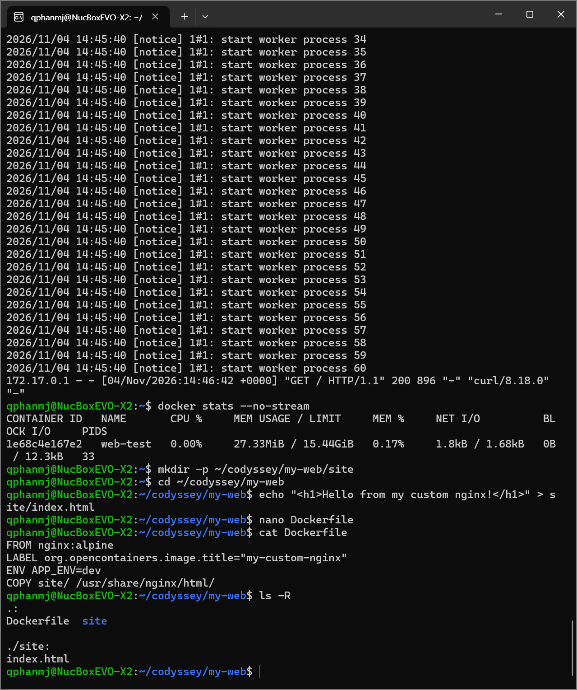

### 8-2. 빌드

```
$ cd app
$ docker build -t my-web:1.0 .
...
 => [2/2] COPY site/ /usr/share/nginx/html/
 => exporting to image
 => => naming to docker.io/library/my-web:1.0

$ docker images
IMAGE                ID             DISK USAGE   CONTENT SIZE   EXTRA
hello-world:latest   c567b231f656       25.9kB         9.49kB    U
my-web:1.0           f2b44703f341       93.6MB         26.3MB
nginx:latest         5ab5b0b01097        243MB         66.8MB    U
ubuntu:latest        6a06111c3b0a        163MB         45.9MB    U
```

alpine 베이스를 써서 `my-web:1.0`(93.6MB)이 `nginx:latest`(243MB)보다 가볍습니다.

### 8-3. 포트 매핑 2회

```
$ docker run -d -p 8080:80 --name my-web-8080 my-web:1.0
$ docker run -d -p 8081:80 --name my-web-8081 my-web:1.0

$ docker ps
CONTAINER ID   IMAGE        COMMAND                  CREATED          STATUS          PORTS                                     NAMES
be4764268059   my-web:1.0   "/docker-entrypoint.…"   53 seconds ago   Up 52 seconds   0.0.0.0:8081->80/tcp, [::]:8081->80/tcp   my-web-8081
d22a2fd66daa   my-web:1.0   "/docker-entrypoint.…"   57 seconds ago   Up 55 seconds   0.0.0.0:8080->80/tcp, [::]:8080->80/tcp   my-web-8080

$ curl -s http://localhost:8080
<h1>Hello from my custom nginx!</h1>

$ curl -s http://localhost:8081
<h1>Hello from my custom nginx!</h1>
```

이미지 하나로 컨테이너 두 개를 만들었습니다. 두 컨테이너 모두 안에서는 80번을 쓰지만, 호스트 포트(8080, 8081)가 달라서 충돌하지 않습니다. 상세 로그: [docs/logs/port_mapping.md](docs/logs/port_mapping.md)

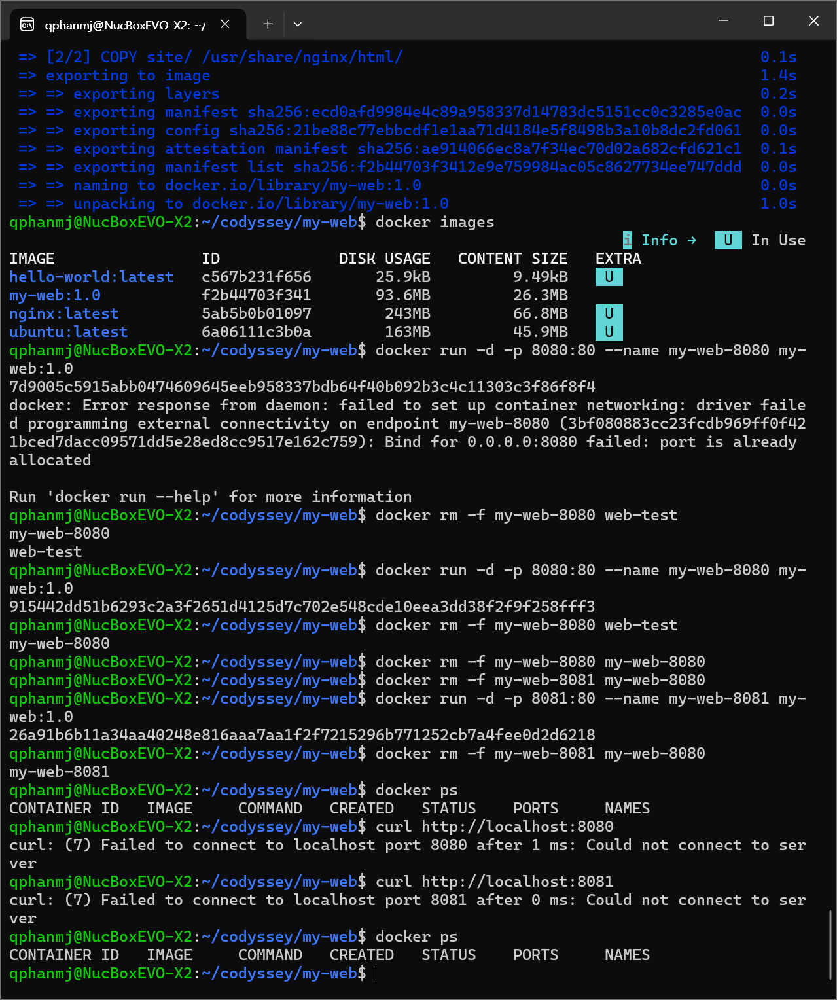

### 8-4. 브라우저 접속 증거

> TODO: 브라우저에서 `http://localhost:8080`, `http://localhost:8081`을 열고 주소창이 보이게 캡처해 `docs/images/13_browser_8080.png`, `14_browser_8081.png`로 추가

---

## 9. 바인드 마운트와 볼륨

상세 로그: [docs/logs/bind_mount_volume.md](docs/logs/bind_mount_volume.md)

### 바인드 마운트: 호스트 변경 전/후

```
$ echo '<h1>Bind mount v1</h1>' > site/index.html
$ docker run -d --name bind-web -p 8082:80 -v "$(pwd)/site:/usr/share/nginx/html" nginx:alpine

$ curl -s http://localhost:8082          # 변경 전
<h1>Bind mount v1</h1>

$ echo '<h1>Bind mount v2 - edited on host</h1>' > site/index.html

$ curl -s http://localhost:8082          # 변경 후 (재시작, 재빌드 없음)
<h1>Bind mount v2 - edited on host</h1>
```

### 볼륨: 컨테이너 삭제 전/후

```
$ docker volume create mydata
$ docker run -d --name vol-test -v mydata:/data ubuntu sleep infinity
$ docker exec vol-test bash -c "echo hi > /data/hello.txt && cat /data/hello.txt"
hi

$ docker rm -f vol-test                  # 컨테이너 삭제

$ docker run -d --name vol-test2 -v mydata:/data ubuntu sleep infinity
$ docker exec vol-test2 cat /data/hello.txt
hi
```

비교로, 볼륨이 아닌 `/tmp`에 쓴 파일은 컨테이너를 지우자 `No such file or directory`가 되었습니다.

| 구분 | `-v` 앞부분 | 데이터 위치 | 확인한 것 |
|---|---|---|---|
| 바인드 마운트 | 호스트 경로 (`$(pwd)/site`) | 내 PC 폴더 | 호스트 수정이 즉시 반영 |
| 볼륨 | 볼륨 이름 (`mydata`) | Docker가 관리하는 저장소 | 컨테이너 삭제 후에도 유지 |

---

## 10. Git 설정과 GitHub 연동

### 10-1. Git 설정

```
$ git config --global user.name "Dongho"
$ git config --global user.email "188280171+Hoyasiro@users.noreply.github.com"
$ git config --global init.defaultBranch main
$ git config --global core.autocrlf input

$ git config --list
user.name=Dongho
user.email=188280171+Hoyasiro@users.noreply.github.com
init.defaultbranch=main
core.autocrlf=input
```

이메일은 개인 메일 대신 GitHub가 주는 공개용(noreply) 주소를 써서, 공개 저장소의 커밋 기록에 개인 메일이 남지 않게 했습니다.

### 10-2. GitHub 연동

> TODO: VS Code에서 GitHub 로그인 → 저장소 생성/연결 → push 후 화면 캡처 추가 (토큰, 인증 코드가 보이지 않게)

---

## 11. 트러블슈팅

### 11-1. Windows 명령 프롬프트에서 리눅스 명령 실행

| 단계 | 내용 |
|---|---|
| 문제 | `pwd` 입력 시 `'pwd'은(는) 내부 또는 외부 명령, 실행할 수 있는 프로그램, 또는 배치 파일이 아닙니다.` |
| 원인 가설 | 리눅스 명령을 Windows 쉘에서 실행했다 |
| 확인 | 프롬프트가 `C:\Users\...>` 형태(Windows 명령 프롬프트)였다 |
| 해결 | `wsl ~`로 Ubuntu에 들어간 뒤 다시 실행. 이후로는 시작 메뉴에서 Ubuntu를 직접 연다 |

### 11-2. Ubuntu에서 docker 명령을 찾을 수 없음

| 단계 | 내용 |
|---|---|
| 문제 | `The command 'docker' could not be found in this WSL 2 distro.` |
| 원인 가설 | Docker Desktop을 Ubuntu보다 먼저 설치해서 Ubuntu와 연결되지 않았다 |
| 확인 | 오류 메시지가 "activate the WSL integration in Docker Desktop settings"를 안내했다 |
| 해결 | Docker Desktop → Settings → Resources → WSL integration에서 Ubuntu를 켜고 Apply & restart |

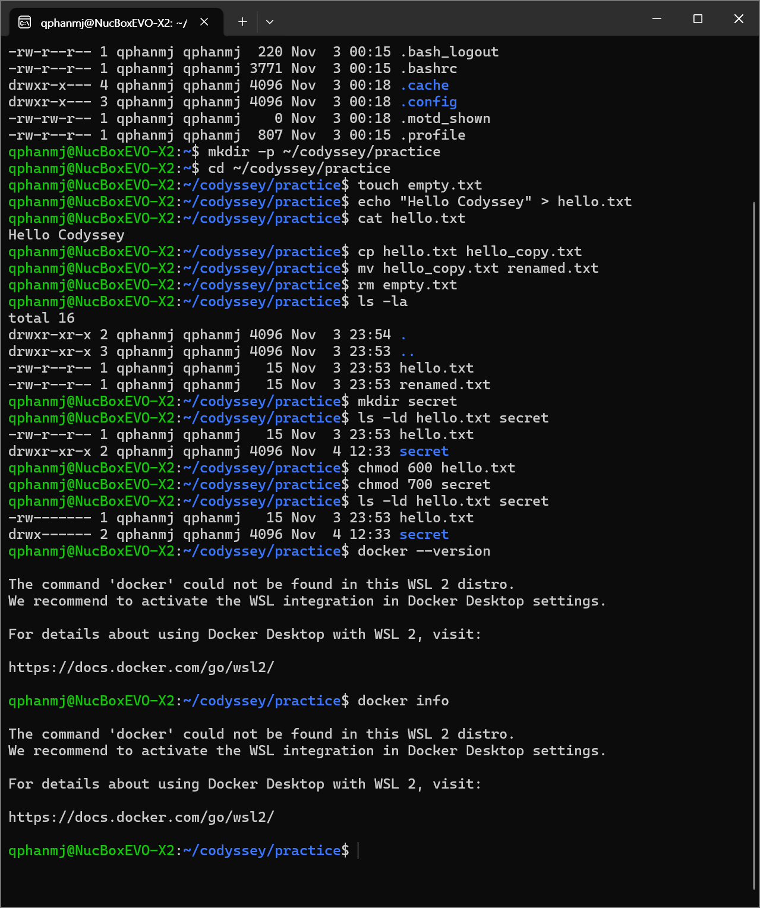

### 11-3. docker.sock 접근 권한 거부

| 단계 | 내용 |
|---|---|
| 문제 | `docker info`의 Server 부분에 `permission denied while trying to connect to the docker API at unix:///var/run/docker.sock` |
| 원인 가설 | 소켓 파일이 `srw-rw---- root docker`(660)라서 `docker` 그룹이 아니면 접근할 수 없다 |
| 확인 | 새 세션에서 `groups`를 보니 `docker` 그룹에 들어가 있었다. 기존 터미널은 그룹이 추가되기 전에 열려서 반영되지 않았다 |
| 해결 | 터미널을 닫고 Ubuntu를 새로 열어 그룹 정보를 다시 읽게 했다 |

```
$ ls -l /var/run/docker.sock
srw-rw---- 1 root docker 0 Nov  4 12:54 /var/run/docker.sock
$ groups
qphanmj adm cdrom sudo dip plugdev users docker
```

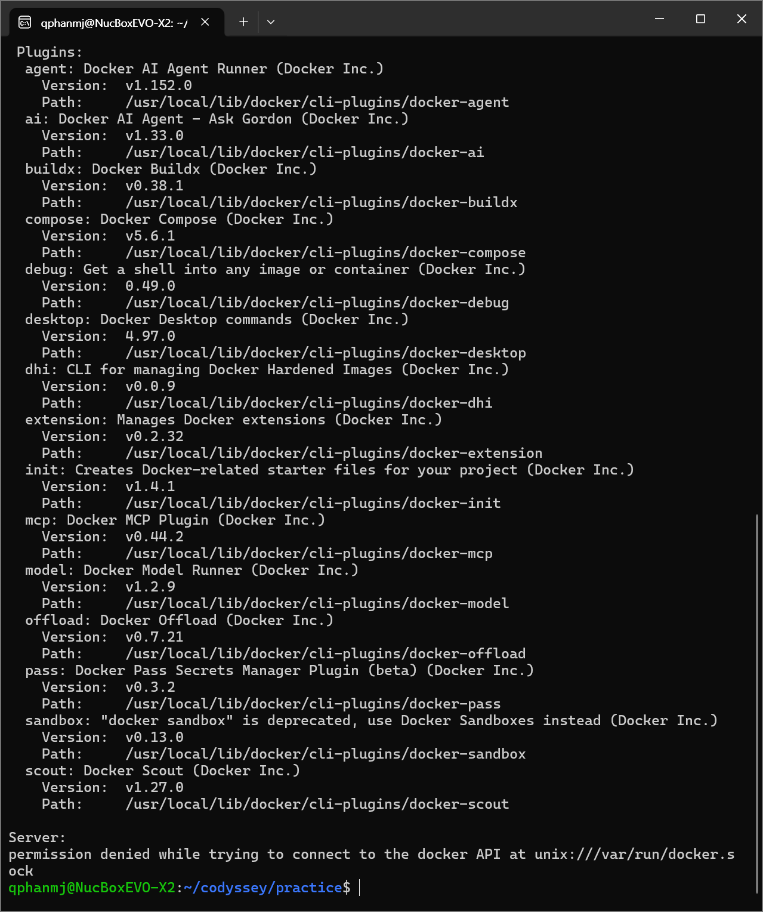

### 11-4. 호스트 포트 충돌

| 단계 | 내용 |
|---|---|
| 문제 | `Bind for 0.0.0.0:8080 failed: port is already allocated` |
| 원인 가설 | 다른 컨테이너(`web-test`)가 이미 호스트 8080 포트를 쓰고 있다 |
| 확인 | `docker ps`의 PORTS에 `0.0.0.0:8080->80/tcp`가 `web-test`에 있었다 |
| 해결 | `docker rm -f my-web-8080 web-test`로 정리 후 다시 실행. 또는 다른 호스트 포트(8081 등) 사용 |

### 11-5. Docker Desktop 설정 화면 오류 (참고)

| 단계 | 내용 |
|---|---|
| 문제 | Settings를 열자 `docker context "desktop-linux" not available ... being used by another process` |
| 원인 가설 | 설정 파일(`meta.json`)을 다른 프로세스가 잠깐 쓰고 있었다 |
| 확인 | 직후 `docker context ls`는 정상이고 파일도 읽혔다 |
| 해결 | 다른 메뉴로 갔다가 Settings를 다시 열거나 Docker Desktop 재시작 |

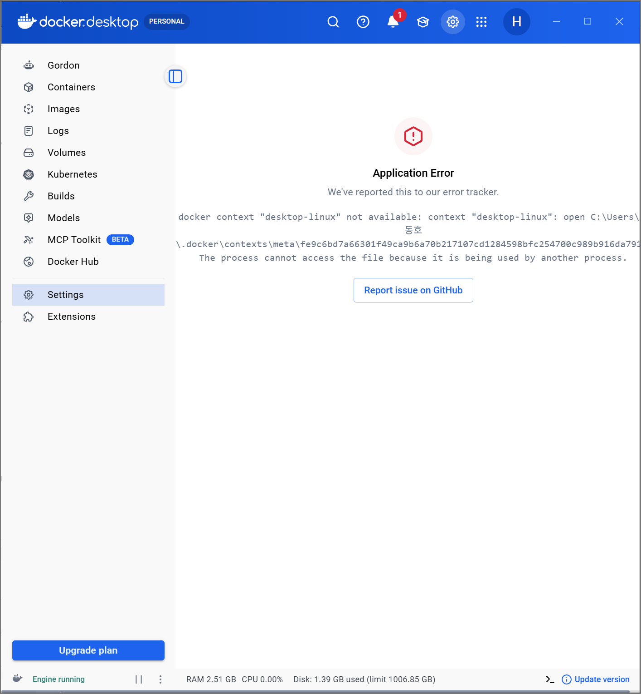

---

## 12. 개념 정리 (과제 목표)

**절대 경로와 상대 경로**
절대 경로는 최상위 `/`부터 쓰는 주소(`/home/qphanmj/codyssey/practice`)라 어디서 써도 같은 곳을 가리킵니다. 상대 경로는 현재 위치 기준(`../docs/README.md`)이라 현재 위치에 따라 가리키는 곳이 달라집니다. `.`은 현재, `..`은 한 단계 위, `~`는 홈입니다.

**파일 권한 (r/w/x, 755, 644)**
r=4, w=2, x=1을 더한 숫자를 소유자, 그룹, 그 외 순서로 씁니다. 755는 `rwxr-xr-x`(소유자 전체, 나머지 읽기/실행), 644는 `rw-r--r--`(소유자 읽기/쓰기, 나머지 읽기)입니다. 디렉토리의 x는 "들어가기"입니다.

**커스텀 이미지**
기존 이미지(`FROM nginx:alpine`) 위에 필요한 것(`COPY`, `ENV`, `LABEL`)을 더해 새 이미지를 만듭니다. 항상 필요한 내용은 이미지에 넣어두면 누가 실행해도 같은 결과가 나옵니다.

**포트 매핑이 필요한 이유**
컨테이너는 격리되어 있어서, 호스트에서 컨테이너 안의 포트에 바로 접속할 수 없습니다. `-p 호스트포트:컨테이너포트`로 연결해야 합니다. 호스트 포트는 하나의 컨테이너만 쓸 수 있습니다.

**Docker 볼륨**
컨테이너 안의 변경은 컨테이너를 지우면 사라집니다. 볼륨은 Docker가 관리하는 별도 저장소라, 컨테이너를 지워도 데이터가 남고 새 컨테이너에 다시 연결할 수 있습니다.

**Git과 GitHub**
Git은 내 PC에서 변경 이력을 관리하는 로컬 버전 관리 도구이고, GitHub는 Git 저장소를 인터넷에 올려 다른 사람과 공유하고 협업하는 원격 플랫폼입니다.

## 13. 보안

- 문서, 로그, 스크린샷에 비밀번호, 토큰, 개인키, 인증 코드를 남기지 않았습니다.
- Git 이메일은 GitHub 공개용(noreply) 주소를 써서 개인 메일을 노출하지 않았습니다.
- 우분투 계정 비밀번호는 입력해도 화면에 표시되지 않으며 기록에 포함하지 않았습니다.
